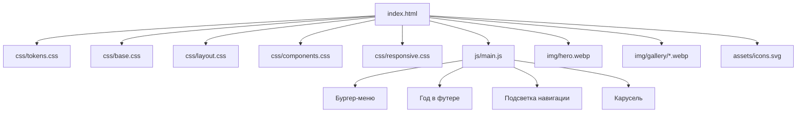

# Анализ проекта CyberZone и архитектурный план оптимизации

Дата: 2026-10-06
Версия плана: 1.0

---

## 1. Текущее состояние проекта

```
sites mb/
├── index.html    — версия 1 (базовая лендинг-страница, без JS)
└── index2.html   — версия 2 (улучшенная, ~1420 строк, бургер-меню на JS)
```

Обе страницы — это одностраничные лендинги компьютерного клуба «CyberZone» на чистом
HTML/CSS/JS без внешних ресурсов, сборки и фреймворков. Проект не имеет структуры папок:
весь CSS находится в `<style>` внутри `<head>`, весь JS — инлайн в конце `<body>`.

### Сильные стороны v2 (индекс 2)
- Дизайн-токены через CSS-переменные в `:root`.
- Семантическая разметка: `header`, `main`, `section`, `article`, `footer`.
- ARIA-атрибуты: `aria-expanded`, `aria-controls`, `aria-labelledby`, `aria-hidden`.
- `prefers-reduced-motion`, `:focus-visible`, `scroll-padding-top`.
- Иконки инлайн-SVG вместо эмодзи.
- Логика бургер-меню с закрытием по Esc и по клику на ссылку.

---

## 2. Перечень технических проблем

### 2.1. Архитектура и структура файлов
| ID | Проблема | Где |
|----|----------|-----|
| A1 | CSS-монолит в `<style>` (~230 строк в v1, ~930 в v2) — стили не переиспользуются, сложно поддерживать | оба файла |
| A2 | JS инлайн в конце body — нет разделения на модули | index2.html:1387 |
| A3 | Нет папок `css/`, `js/`, `img/`, `assets/` — всё в корне | проект |
| A4 | Две версии одного сайта с конфликтующими данными: email `play@cyberzone.ru` vs `hello@neonarena.ru`, адрес «ул. Геймеров, 42» vs «ул. Киберспортивная, 15, м. Сокольники», телефон +7(999)777-77-77 vs +7(495)123-45-67 | оба файла |
| A5 | Статичные данные: год в футере (2025/2026), даты турниров — устаревают без редактирования кода | оба файла |

### 2.2. HTML-разметка и семантика
| ID | Проблема | Где |
|----|----------|-----|
| M1 | Нет `<main>`-ландмарка (только в v2 есть; в v1 отсутствует) | index.html |
| M2 | Эмодзи-«картинки» (🖥️🎧, слайды, иконки) без `alt` и без `aria-hidden` — нестабильное отображение на разных платформах, шум для скринридеров | index.html:274,287-290 |
| M3 | Инлайн-стили в разметке: `style="margin-top:1rem"`, `style="width:100%"` | index.html:267,361; index2.html:1141,1162,1183 |
| M4 | 9 копий одинакового SVG-чекбокса в тарифах — раздувание DOM | index2.html:1129-1179 |
| M5 | Нет `<noscript>`-фолбэка: на мобильных навигация скрыта CSS и недоступна без JS | index2.html:964 |
| M6 | Нет favicon, нет OG-тегов (`og:image`), нет JSON-LD | оба файла |

### 2.3. CSS
| ID | Проблема | Где |
|----|----------|-----|
| C1 | Цвета захардкожены десятки раз (`#00F0FF`, `#0D0D0D`) без переменных | index.html |
| C2 | Липкая шапка перекрывает якорные секции — нет `scroll-padding-top` (в v1; в v2 исправлено) | index.html:31 |
| C3 | Массовый `backdrop-filter` + многослойные тени — нагрузка на слабые мобильные устройства, нет `@supports`-фолбэка | index2.html |
| C4 | Бейдж «Популярный» с `top:-12px` может обрезаться (нет запаса в сетке) | index2.html:573 |
| C5 | Нет единой системы отступов/типографики в v1; размеры в `rem` и `px` вперемешку | index.html |

### 2.4. JS и поведение
| ID | Проблема | Где |
|----|----------|-----|
| J1 | Карусель только на CSS: нет стрелок/точек, свайпа, клавиатуры, ARIA, паузы по фокусу; hover-пауза не работает на тач-устройствах | index.html:116-159 |
| J2 | Мобильное меню: нет блокировки скролла `body`, нет focus-trap, фокус не возвращается в бургер при закрытии вне клавиатуры | index2.html:1387 |
| J3 | Нет подсветки активного пункта навигации при скролле | оба файла |
| J4 | Нет динамической подстановки года в футер | оба файла |
| J5 | Нет формы бронирования — все CTA-кнопки ведут на `#contacts` | оба файла |

### 2.5. Доступность и SEO
| ID | Проблема |
|----|----------|
| X1 | Нет skip-link («Перейти к содержимому») |
| X2 | Нет `aria-current` для активных пунктов меню |
| X3 | Контраст: `#00F0FF` (циан) как цвет текста на тёмном фоне — проверка WCAG (использовать для акцентов, а не для текста) |
| X4 | `meta keywords` — устаревшая практика (в v1) |
| X5 | Нет JSON-LD `LocalBusiness`/`EntertainmentBusiness` — локальный бизнес теряет сниппеты в поиске |
| X6 | Нет карты/embed, хотя секция называется «как добраться» |
| X7 | Шрифты Google Fonts — рендер-блокирующая загрузка без `preload` (v2: `display=swap` есть, но нет `preload` woff2) |

### 2.6. Производительность
| ID | Проблема |
|----|----------|
| P1 | Нет реальных изображений — галерея и «о клубе» состоят из эмодзи (замена на фото с `srcset`, `loading="lazy"`, `width/height`) |
| P2 | Нет `defer`/`async` для скриптов (инлайн-скрипт блокирует парсинг) |
| P3 | Нет минификации/объединения ресурсов (для статического проекта приемлемо, но структура должна позволять это в будущем) |
| P4 | Повторяющийся SVG-код и дублирование CSS-правил между файлами увеличивают вес страницы |

---

## 3. Целевая архитектура

Решение: свести проект к **одной канонической лендинг-странице** `index.html`,
объединив лучшее из обеих версий (дизайн-система v2 + секции «О клубе»/«Галерея» из v1).



### Итоговая структура папок

```
sites mb/
├── index.html              — каноническая главная страница
├── css/
│   ├── tokens.css          — переменные, дизайн-токены (цвета, шрифты, радиусы, тени)
│   ├── base.css            — reset, типографика, утилиты, focus, reduced-motion
│   ├── layout.css          — header, hero, секции, footer, сетки
│   ├── components.css      — кнопки, карточки, карусель, тарифы, формы
│   └── responsive.css      — медиазапросы 480/768/1024/1280
├── js/
│   └── main.js             — бургер, год, активная навигация, карусель, форма
├── img/
│   ├── hero.webp           — фон/фото hero (с srcset 1x/2x)
│   ├── gallery/*.webp      — фотографии клуба
│   ├── og-cover.jpg        — картинка для соцсетей 1200x630
│   └── favicon.svg
└── assets/
    └── icons.svg           — SVG-спрайт с <symbol> для <use>
```

---

## 4. Этапы реализации

### Этап 1. Контент и данные
- Согласовать эталон бренда: название, адрес, телефон, email, ссылки на соцсети,
  тарифы, зоны, турниры. Все расхождения v1/v2 зафиксировать и выбрать один вариант.
- Вынести повторяющиеся данные (контакты, тарифы) в единый источник — для чистого
  HTML это структурированные секции; при желании позже — в `data.js`.

### Этап 2. Структура и CSS-модули
- Создать папки `css/`, `js/`, `img/`, `assets/`.
- Перенести стили v2 в 5 модулей по назначению; адаптировать секции «О клубе»
  и «Галерея» из v1 под дизайн-токены v2.
- Убрать все инлайн-стили; добавить классы-утилиты (например, `.btn-block`).

### Этап 3. JS-модуль
- Вынести скрипт в `js/main.js` с `defer`:
  - бургер-меню (ARIA, блокировка скролла, focus-trap, закрытие по Esc);
  - динамический год в футере;
  - подсветка активного пункта меню через IntersectionObserver;
  - плавный скролл (усиление нативного `scroll-behavior`);
  - карусель (см. Этап 5);
  - обработка формы бронирования (см. Этап 8).

### Этап 4. Медиа и иконки
- Эмодзи → иконки из SVG-спрайта (`<svg><use href="assets/icons.svg#icon-x">`).
- «Картинки» → реальные фото: WebP + `srcset`, `width`/`height` (без CLS),
  `loading="lazy"` для ниже первого экрана, осмысленные `alt`.

### Этап 5. Карусель
- Переписать на JS: стрелки, точки-индикаторы, свайп, клавиатура (←/→),
  пауза при hover/focus, `aria-roledescription="carousel"`, `aria-live="polite"`,
  корректное поведение при `prefers-reduced-motion` (отключить автопрокрутку).

### Этап 6. Доступность
- Skip-link в начало body.
- `aria-current="true"` для активного пункта меню.
- `<noscript>`-вариант меню (показать навигацию).
- Проверка контраста: циан — только акценты; текст — светлые нейтральные тона.
- Все формы — с `<label>` и понятными подсказками об ошибках.

### Этап 7. SEO и метаданные
- Единый head-блок: title, description, canonical, OG (title/description/image/url),
  twitter:card, favicon (svg + apple-touch-icon).
- JSON-LD `EntertainmentBusiness`/`LocalBusiness` с адресом, телефоном, часами работы.
- Один `<h1>` на страницу.

### Этап 8. Форма бронирования
- Секция «Забронировать»: имя, зона, дата/время, телефон, комментарий.
- Валидация HTML5 + JS-подсказки.
- Отправка без бэкенда: формирование сообщения и переход на Telegram
  (`https://t.me/...?text=...`) или `mailto:`. Согласовать способ с владельцем.

### Этап 9. Производительность
- `preconnect` + `preload` шрифтов (woff2), `display=swap`.
- `defer` для скриптов, ленивая загрузка изображений.
- `@supports (backdrop-filter: blur(1px))` с фолбэком на непрозрачный фон.
- Минимизация повторов SVG/DOM.

### Этап 10. QA и сдача
- Валидация W3C (HTML/CSS), axe/Lighthouse: Performance, Accessibility, SEO ≥ 90.
- Адаптив: 360, 768, 1024, 1280 px; тач-свайпы; клавиатура.
- Проверка без JS (graceful degradation).
- Старую версию заархивировать или удалить после согласования.

---

## 5. Критерии готовности (Definition of Done)

- [ ] Одна каноническая `index.html` без конфликтующих данных.
- [ ] Структура `css/`, `js/`, `img/`, `assets/`; ни одного инлайн-стиля.
- [ ] Нет эмодзи-заглушек; все изображения оптимизированы и имеют `alt`.
- [ ] Карусель управляется с клавиатуры и тача; меню доступно без JS.
- [ ] Lighthouse: Performance/Accessibility/SEO ≥ 90, W3C без ошибок.
- [ ] Форма бронирования работает (Telegram/mailto) и проходит валидацию.